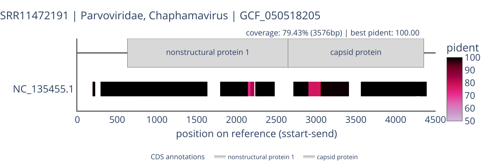

# viral_genome_annotator

Genome annotation visualizer for virome analysis — aligns detected viral genomes against known references and renders interactive HTML figures.

## Requirements

- conda ([Miniforge](https://github.com/conda-forge/miniforge) recommended)
- Git

## Installation

```bash
git clone https://github.com/virus-informatics/virome_happybox
cd viral_genome_annotator
conda env create -f environment.yml
conda activate viral_genome_annotator
```

This installs `viral_genome_annotator` with the `run`, `blast`, `visualize`, and `update_refseq` subcommands.

## Reference Data

Download the pre-built reference data from [GitHub Releases](https://github.com/TODO/viral_genome_annotator/releases). Each release is tagged as `refseq_viral_YYYYMMDD` (e.g. `refseq_viral_20260714`).

```bash
# Download the asset
curl -LO https://github.com/virus-informatics/virome_happybox/releases/download/refseq_viral_20260714/refseq_viral_20260714.tar.gz

# Extract into the default --refseq-dir location
mkdir -p output_dir
tar xzf refseq_viral_20260714.tar.gz -C output_dir
```

Once extracted, the `run`, `blast`, and `visualize` subcommands will find the reference data automatically (default: `output_dir/update_refseq`).

## Tutorial: Run with example data

The `example/` directory contains two small query FASTA files (Parvoviridae contigs assembled from SRA runs).

> [!IMPORTANT]
> Reference data must be set up before running. See [Reference Data](#reference-data) above.

```bash
# Run the full pipeline on one of the example files
viral_genome_annotator run -i example/SRR10294002_Parvoviridae.fasta

# Then run the other example as well
viral_genome_annotator run -i example/SRR11472191_Parvoviridae.fasta
```

This will:

1. Run tblastx against the reference database
2. Generate interactive HTML figures under `output_dir/visualize/figures/`

Open the resulting `.html` files in a browser to explore the genome annotation visualization.
Each figure can also be saved as SVG via the camera icon in its toolbar.



## Quick Start

The simplest way to run the full pipeline (BLAST + visualization) is the `run` subcommand:

```bash
viral_genome_annotator run -i <query.fasta> --db <blast-db-path>
```

For available options:

```bash
viral_genome_annotator run --help
```

### Command Line Options

| Option                | Required | Default                                               | Description                          |
| :-------------------- | :------: | :---------------------------------------------------- | :----------------------------------- |
| `-i`, `--input`       |    Y     | -                                                     | Query FASTA file                     |
| `-o`, `--outdir`      |    N     | `output_dir`                                          | Working directory                    |
| `--db`                |    N     | `output_dir/update_refseq/blast_db/refseq_viral_nucl` | BLAST DB path                        |
| `--threads`           |    N     | `4`                                                   | Number of threads for tblastx        |
| `--force`             |    N     | -                                                     | Re-run tblastx even if output exists |
| `--refseq-dir`        |    N     | `output_dir/update_refseq`                            | Directory containing reference data  |
| `--title`             |    N     | auto-generated                                        | Figure title                         |
| `--min-covered-bases` |    N     | `500`                                                 | Minimum covered bases to include     |
| `--max-track-count`   |    N     | `15`                                                  | Maximum tracks per figure            |

## Running Individual Commands

If you prefer to run each step separately, use `blast` followed by `visualize`.

### 1. blast

Run tblastx against the reference database:

```bash
viral_genome_annotator blast -i <query.fasta> --db <blast-db-path>
```

| Option           | Required | Default        | Description                      |
| :--------------- | :------: | :------------- | :------------------------------- |
| `-i`, `--input`  |    Y     | -              | Query FASTA file                 |
| `-o`, `--outdir` |    N     | `output_dir`   | Working directory                |
| `--db`           |    Y     | -              | BLAST DB path                    |
| `--output-tsv`   |    N     | auto-generated | Output TSV path                  |
| `--threads`      |    N     | `4`            | Number of threads                |
| `--force`        |    N     | -              | Re-run even if output TSV exists |

### 2. visualize

Generate interactive HTML figures from BLAST results:

```bash
# Auto-detect TSV files from outdir/tblastx/
viral_genome_annotator visualize

# Specify BLAST TSV files explicitly
viral_genome_annotator visualize -i SRR001.tblastx.tsv SRR002.tblastx.tsv
```

| Option                | Required | Default                    | Description                         |
| :-------------------- | :------: | :------------------------- | :---------------------------------- |
| `-i`, `--input`       |    N     | auto-detect                | BLAST TSV files (multiple allowed)  |
| `-o`, `--outdir`      |    N     | `output_dir`               | Working directory                   |
| `--refseq-dir`        |    N     | `output_dir/update_refseq` | Directory containing reference data |
| `--title`             |    N     | auto-generated             | Figure title                        |
| `--min-covered-bases` |    N     | `500`                      | Minimum covered bases to include    |
| `--max-track-count`   |    N     | `15`                       | Maximum tracks per figure           |

### Outputs

```
<outdir>/
├── tblastx/
│   └── <sample>.tblastx.tsv        # BLAST results
└── visualize/
    ├── blast_best_hit.tsv           # Best-hit summary (with Assembly IDs)
    └── figures/
        ├── blast_<Family>_<GCF>.html
        └── ...
```

## Updating Reference Data

> [!IMPORTANT]
> Most users should use the pre-built reference data from GitHub Releases (see [Reference Data](#reference-data)).
> This section is only for users who need to rebuild the reference database from NCBI themselves.

The `update_refseq` subcommand fetches and builds reference data from NCBI. It requires an additional dependency:

```bash
conda install -c bioconda taxonkit=0.20.0
```

### Full pipeline

```bash
viral_genome_annotator update_refseq run
```

This runs all steps below in sequence: `download-refseq` → `download-assembly` → `gen_meta` → `gen_db`.

| Option               | Required | Default                    | Description                              |
| :------------------- | :------: | :------------------------- | :--------------------------------------- |
| `-o`, `--output-dir` |    N     | `output_dir/update_refseq` | Output directory                         |
| `--taxdump-dir`      |    N     | `<output-dir>/taxdump`     | Extracted taxdump directory for taxonkit |
| `--update-taxdump`   |    N     | off                        | Also download/update NCBI taxdump        |

> [!NOTE]
> taxdump is automatically downloaded on first run. Subsequent runs skip taxdump by default.
> Use `--update-taxdump` to explicitly update taxdump to the latest version.

### Individual steps

#### download-refseq

Download reference files from NCBI FTP:

```bash
viral_genome_annotator update_refseq download-refseq
```

| Option               | Required | Default                    | Description                       |
| :------------------- | :------: | :------------------------- | :-------------------------------- |
| `-o`, `--output-dir` |    N     | `output_dir/update_refseq` | Output directory                  |
| `--update-taxdump`   |    N     | off                        | Also download/update NCBI taxdump |

Downloaded files:

| File                       | Source                                                                | Purpose                         |
| :------------------------- | :-------------------------------------------------------------------- | :------------------------------ |
| `viral.1.1.genomic.fna.gz` | NCBI RefSeq viral (https://ftp.ncbi.nlm.nih.gov/refseq/release/viral) | BLAST DB input                  |
| `viral.1.genomic.gbff.gz`  | NCBI RefSeq viral (https://ftp.ncbi.nlm.nih.gov/refseq/release/viral) | Gene annotations (CDS)          |
| `taxdump.tar.gz` → `*.dmp` | NCBI Taxonomy (https://ftp.ncbi.nih.gov/pub/taxonomy/)                | Lineage resolution via taxonkit |

#### download-assembly

Download GCF → NC assembly mappings from NCBI Datasets API:

```bash
viral_genome_annotator update_refseq download-assembly
```

| Option               | Required | Default                    | Description                |
| :------------------- | :------: | :------------------------- | :------------------------- |
| `-o`, `--output-dir` |    N     | `output_dir/update_refseq` | Output directory           |
| `--batch-size`       |    N     | `500`                      | Accessions per API request |

#### gen_meta

Generate GFF3 annotations and taxonomy table from GBFF:

```bash
viral_genome_annotator update_refseq gen_meta
```

| Option               | Required | Default                    | Description                              |
| :------------------- | :------: | :------------------------- | :--------------------------------------- |
| `-o`, `--output-dir` |    N     | `output_dir/update_refseq` | Output directory                         |
| `--taxdump-dir`      |    N     | `<output-dir>/taxdump`     | Extracted taxdump directory for taxonkit |

#### gen_db

Build BLAST database from FASTA:

```bash
viral_genome_annotator update_refseq gen_db
```

| Option               | Required | Default                    | Description      |
| :------------------- | :------: | :------------------------- | :--------------- |
| `-o`, `--output-dir` |    N     | `output_dir/update_refseq` | Output directory |

### Output directory structure

```
<output-dir>/
├── downloads/
│   ├── download_meta.json
│   ├── viral.1.1.genomic.fna.gz
│   ├── viral.1.genomic.gbff.gz
│   ├── assembly_summary.txt
│   └── assembly_zips/
│       └── batch_manifest.jsonl  # Batches fetched and extracted successfully (one line per batch)
├── assembly/
│   └── assembly_map.json
├── taxdump/
│   ├── names.dmp
│   ├── nodes.dmp
│   └── download_meta.json
├── annotations.gff3          # CDS only (the feature type used by visualize)
├── taxonomy.tsv
└── blast_db/
    └── refseq_viral_nucl.*
```

## Troubleshooting

### "command not found: viral_genome_annotator"

Ensure the conda environment is activated:

```bash
conda activate viral_genome_annotator
```

### BLAST DB errors

If `blast` or `run` fails with a database error, verify the `--db` path points to a valid BLAST database (built by `update_refseq gen_db` or provided separately).

### taxonkit errors in update_refseq

Ensure taxonkit is installed and the taxdump files exist:

```bash
taxonkit version
ls <output-dir>/taxdump/*.dmp
```

## For Maintainers: Publishing Reference Data

How to publish pre-built reference data to GitHub Releases.

### 1. Build reference data

See [Updating Reference Data](#updating-reference-data) for prerequisites (taxonkit, etc.).

```bash
viral_genome_annotator update_refseq run -o output_dir/update_refseq
```

### 2. Create the archive

```bash
DATE=$(date +%Y%m%d)
tar czf refseq_viral_${DATE}.tar.gz -C output_dir update_refseq
```

### 3. Tag and create GitHub Release

```bash
DATE=$(date +%Y%m%d)
git tag refseq_viral_${DATE}
git push origin refseq_viral_${DATE}
gh release create refseq_viral_${DATE} \
  --title "RefSeq Viral Reference Data (${DATE})" \
  refseq_viral_${DATE}.tar.gz
```
