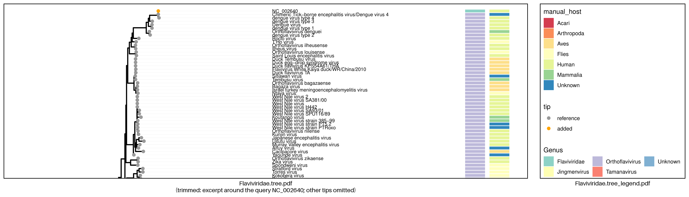

# viral_phylogeny_builder

Phylogenetic tree builder for virome analysis — extracts RdRp sequences from NCBI reference genomes, builds a per-family reference tree, and places query contigs onto it.

## Requirements

- conda ([Miniforge](https://github.com/conda-forge/miniforge) recommended)
- Git

## Installation

```bash
git clone https://github.com/virus-informatics/virome_happybox.git
cd virome_happybox/viral_phylogeny_builder
conda env create -f environment.yml
conda activate viral_phylogeny_builder
```

This installs `viral_phylogeny_builder` with the `update-reference`, `build-reftree`, and `query` commands.

## Prerequisite: Setting Up Reference Data

`query` requires the following pre-built reference data, published as two GitHub Releases.
Extract all of them into `reference/`.

| Asset                     | Release tag        | Contents                                                                                                                    |
| :------------------------ | :----------------- | :-------------------------------------------------------------------------------------------------------------------------- |
| `reftree_YYYYMMDD.tar.gz` | `reftree_YYYYMMDD` | Reference alignment (`--reference-alignment`), reference taxon CSV (`--reference-taxon-csv`) and tree of every virus family |
| `rdrp_db_YYYYMMDD.tar.gz` | `rdrp_db_YYYYMMDD` | Curated RdRp FASTA of every virus family (`--rdrp-db`)                                                                      |
| `taxdump.tar.gz`          | `reftree_YYYYMMDD` | NCBI taxdump used to resolve host names                                                                                     |

The two releases are versioned independently, so their dates usually differ.
Pick the latest [`reftree_YYYYMMDD` release](https://github.com/virus-informatics/virome_happybox/releases?q=reftree&expanded=true), and use the `rdrp_db_YYYYMMDD` release named in its release notes, which is the one the reference trees were built with.

```bash
# Replace with the actual tags from the release pages
REFTREE_TAG=reftree_YYYYMMDD
RDRP_DB_TAG=rdrp_db_YYYYMMDD

RELEASE_URL=https://github.com/virus-informatics/virome_happybox/releases/download

mkdir -p reference

# Reference Trees
curl -fLO "${RELEASE_URL}/${REFTREE_TAG}/${REFTREE_TAG}.tar.gz"
tar xzf "${REFTREE_TAG}.tar.gz" -C reference

curl -fLO "${RELEASE_URL}/${REFTREE_TAG}/taxdump.tar.gz"
tar xzf taxdump.tar.gz -C reference

# Curated RdRp DB
curl -fLO "${RELEASE_URL}/${RDRP_DB_TAG}/${RDRP_DB_TAG}.tar.gz"
tar xzf "${RDRP_DB_TAG}.tar.gz" -C reference
```

Once extracted, `reference/` contains:

```
reference/
├── taxdump/
├── rdrp_db/<VirusFamily>.rdrp.clean.fasta
└── build-reftree/{search,align,visualize}/<VirusFamily>/
```

## Tutorial: Run with example data

The `example/` directory contains a query FASTA and its host CSV:

- `dengue.fasta`: Dengue virus 4 complete genome (NCBI RefSeq [NC_002640.1](https://www.ncbi.nlm.nih.gov/nuccore/NC_002640.1))
- `dengue_host.csv`: Host of the contig (`Homo sapiens`)

> [!IMPORTANT]
> Reference data must be set up before running. See [Prerequisite: Setting Up Reference Data](#prerequisite-setting-up-reference-data) above.

```bash
viral_phylogeny_builder query run --virus-family Flaviviridae \
  --input-fasta example/dengue.fasta \
  --host-csv example/dengue_host.csv \
  --reference-alignment reference/build-reftree/align/Flaviviridae/Flaviviridae.final.faa \
  --reference-taxon-csv reference/build-reftree/visualize/Flaviviridae/Flaviviridae.tree_metadata.csv \
  --rdrp-db reference/rdrp_db/Flaviviridae.rdrp.clean.fasta
```

This will:

1. Extract RdRp ORFs from the query contig (getorf + BLASTP)
2. Add the query RdRp to the reference alignment (MAFFT `--add` + trimAl)
3. Build the tree with IQ-TREE and render it under `output_dir/query/visualize/Flaviviridae/`



The figure above is trimmed for display. The original figures are [`example/figures/Flaviviridae.tree.pdf`](./example/figures/Flaviviridae.tree.pdf) and [`example/figures/Flaviviridae.tree_legend.pdf`](./example/figures/Flaviviridae.tree_legend.pdf).

## Quick Start

Place query contigs onto the reference tree of `FAMILY` with the `query run` subcommand:

```bash
viral_phylogeny_builder query run --virus-family ${FAMILY} \
  --input-fasta <query.fasta> \
  --host-csv <host.csv> \
  --reference-alignment reference/build-reftree/align/${FAMILY}/${FAMILY}.final.faa \
  --reference-taxon-csv reference/build-reftree/visualize/${FAMILY}/${FAMILY}.tree_metadata.csv \
  --rdrp-db reference/rdrp_db/${FAMILY}.rdrp.clean.fasta
```

For available options:

```bash
viral_phylogeny_builder query run --help
```

### Common Options

The following options are available on every subcommand.

| Option               | Required | Default                                                               | Description                              |
| :------------------- | :------: | :-------------------------------------------------------------------- | :--------------------------------------- |
| `--virus-family`     |    Y     | -                                                                     | Virus family name (e.g. `Coronaviridae`) |
| `-o`, `--output-dir` |    N     | `output_dir` (`reference` for `update-reference` and `build-reftree`) | Output directory                         |
| `--force`            |    N     | -                                                                     | Re-run even if output already exists     |
| `--tool-config`      |    N     | `config.toml` (if present)                                            | TOML file with external tool paths       |

See [Configuring Custom Tool Paths](#configuring-custom-tool-paths) for `--tool-config`.

### query run Options

| Option                  | Required | Default             | Description                                                                       |
| :---------------------- | :------: | :------------------ | :-------------------------------------------------------------------------------- |
| `--input-fasta`         |    Y     | -                   | Query nucleotide FASTA                                                            |
| `--host-csv`            |    Y     | -                   | Per-contig host annotation CSV (see [Host CSV](#host-csv))                        |
| `--reference-alignment` |    Y     | -                   | Reference alignment (`<family>.final.faa` from `build-reftree align`)             |
| `--reference-taxon-csv` |    Y     | -                   | Reference taxon CSV (`<family>.tree_metadata.csv` from `build-reftree visualize`) |
| `--rdrp-db`             |    Y     | -                   | Curated RdRp FASTA                                                                |
| `--threads`             |    N     | `4`                 | Number of threads                                                                 |
| `--disable-midpoint`    |    N     | off                 | Disable midpoint rooting of the tree                                              |
| `--blastp-evalue`       |    N     | `1e-05`             | BLASTP E-value threshold                                                          |
| `--gap-threshold-pct`   |    N     | `70`                | Maximum gap percentage for sequence filtering                                     |
| `--taxdump-dir`         |    N     | `reference/taxdump` | Directory holding the NCBI taxdump that taxonkit reads                            |

> [!NOTE]
> Host names in `--host-csv` are resolved with taxonkit using the NCBI taxdump in `--taxdump-dir`.

## Input File Formats

### Host CSV

Per-contig host annotation passed to `--host-csv`.

| Column   | Required | Description                                                                            |
| :------- | :------: | :------------------------------------------------------------------------------------- |
| `contig` |    Y     | Contig ID (must match the FASTA header)                                                |
| `host`   |    Y     | Scientific name of the host in NCBI Taxonomy (e.g. `Homo sapiens`, `Mammalia`, `Aves`) |

- A header row is required
- `host` is resolved with `taxonkit name2taxid --sci-name`, so only scientific names match
- Column names are matched ignoring case, underscores, and spaces (e.g. `Query_Name` is recognized as `contig`)
- Version suffixes on contig IDs (e.g. `.1`) are removed automatically
- UTF-8 with BOM is supported

```csv
contig,host
NC_048211,Mammalia
NC_046965,Aves
NC_009988,unknown
```

## Outputs

```
<output-dir>/
└── query/
    ├── search/<family>/
    │   ├── <family>.evalue_<evalue>.renamed.fasta   # Query RdRp ORFs
    │   └── <family>.evalue_<evalue>.name_map.tsv
    ├── align/<family>/
    │   └── final.fasta                              # Reference + query alignment
    └── visualize/<family>/
        ├── <family>.iqtree.treefile
        ├── <family>.concat_metadata.csv
        ├── <family>.tree.pdf
        └── <family>.tree_legend.pdf
```

## Running Individual Commands

If you prefer to run each step separately, use `search`, `align`, and `visualize` in order.
All of them also accept the [Common Options](#common-options).

| Subcommand  | Description                                                            | Required options                                                                                            |
| :---------- | :--------------------------------------------------------------------- | :---------------------------------------------------------------------------------------------------------- |
| `search`    | RdRp homology search for query contigs via getorf + BLASTP             | `--input-fasta`, `--rdrp-db`                                                                                |
| `align`     | Add query RdRp to the reference alignment (MAFFT `--add` + trimAl)     | `--query-rdrp-fasta` (`*.renamed.fasta` from `search`), `--reference-alignment`                             |
| `visualize` | Build the tree (IQ-TREE) and render it with query + reference metadata | `--alignment-fasta` (from `align`), `--name-map-tsv` (from `search`), `--host-csv`, `--reference-taxon-csv` |

For the full list of options:

```bash
viral_phylogeny_builder query <subcommand> --help
```

## Advanced Usage

### Building Reference Trees with Custom Sequences

For users who want to build their own reference phylogenetic trees, either from NCBI data or from a custom sequence dataset.

Reference trees are built per virus family with `update-reference` followed by `build-reftree`.
The Curated RdRp DB is required.

```bash
FAMILY=Bornaviridae

# 1. Fetch NCBI metadata and download representative reference genomes
viral_phylogeny_builder update-reference run --virus-family ${FAMILY}

# 2. Build the reference tree
viral_phylogeny_builder build-reftree run --virus-family ${FAMILY} \
  --genome-fasta reference/update-reference/fetch-genome/${FAMILY}/reference_genomes/ncbi_dataset/data/genomic.fna \
  --reference-metadata-csv reference/update-reference/fetch-metadata/${FAMILY}/reference_metadata.csv \
  --rdrp-db reference/rdrp_db/${FAMILY}.rdrp.clean.fasta
```

#### Inputs of the Published Reference Trees

Each `reftree_YYYYMMDD` release also has `<VirusFamily>.update-reference.tar.gz`, the `update-reference` outputs for one virus family.
It is not needed for `query`.
It contains the NCBI metadata and reference genomes the trees were built from, so that the inputs of a release can be traced later.
Some are large (around 1 GB for Coronaviridae). Download it only when needed:

```bash
curl -fLO ${RELEASE_URL}/${REFTREE_TAG}/${FAMILY}.update-reference.tar.gz
tar xzf ${FAMILY}.update-reference.tar.gz -C reference
```

Once extracted, `reference/` contains `update-reference/{fetch-metadata,fetch-genome}/<VirusFamily>/`.

#### update-reference run Options

| Option                  | Required | Default                | Description                              |
| :---------------------- | :------: | :--------------------- | :--------------------------------------- |
| `--exclude-virus-taxid` |    N     | `2697049` (SARS-CoV-2) | NCBI taxonomy ID to exclude              |
| `--taxdump-dir`         |    N     | `<output-dir>/taxdump` | Extracted taxdump directory for taxonkit |
| `--update-taxdump`      |    N     | off                    | Also download/update NCBI taxdump        |

> [!NOTE]
> taxdump is automatically downloaded into `<output-dir>/taxdump` on first run. Subsequent runs skip taxdump by default.
> Use `--update-taxdump` to explicitly update taxdump to the latest version.
> When `--taxdump-dir` is given, the directory is only checked for the required files and is never downloaded into.

#### build-reftree run Options

| Option                     | Required | Default | Description                                                     |
| :------------------------- | :------: | :------ | :-------------------------------------------------------------- |
| `--genome-fasta`           |    Y     | -       | Reference genome FASTA (from `update-reference fetch-genome`)   |
| `--reference-metadata-csv` |    Y     | -       | Reference metadata CSV (from `update-reference fetch-metadata`) |
| `--rdrp-db`                |    Y     | -       | Curated RdRp FASTA                                              |
| `--threads`                |    N     | `4`     | Number of threads                                               |
| `--disable-midpoint`       |    N     | off     | Disable midpoint rooting of the tree                            |

#### Individual steps

| Command            | Subcommand       | Description                                                   | Required options                                                          |
| :----------------- | :--------------- | :------------------------------------------------------------ | :------------------------------------------------------------------------ |
| `update-reference` | `fetch-metadata` | Fetch NCBI virus metadata and select representative sequences | -                                                                         |
| `update-reference` | `fetch-genome`   | Download reference genomes listed by `fetch-metadata`         | -                                                                         |
| `build-reftree`    | `search`         | Extract RdRp sequences via getorf + MMseqs2                   | `--genome-fasta`, `--reference-metadata-csv`, `--rdrp-db`                 |
| `build-reftree`    | `align`          | Multiple sequence alignment via MAFFT + trimAl                | `--rdrp-fasta`, `--rdrp-metadata-csv` (from `search`)                     |
| `build-reftree`    | `visualize`      | Build the tree (IQ-TREE) and render it                        | `--alignment-fasta` (from `align`), `--rdrp-metadata-csv` (from `search`) |

#### Output directory structure

```
<output-dir>/
├── taxdump/                                  # NCBI taxdump for taxonkit
├── update-reference/
│   ├── fetch-metadata/<family>/
│   │   ├── virus_genome_metadata.csv         # All NCBI records for the family
│   │   ├── lineage.csv                       # Records with virus/host lineage
│   │   ├── complete_length_filtered.csv      # COMPLETE records after length filtering
│   │   ├── reference_metadata.csv            # One representative per virus taxid
│   │   └── reference_accessions.txt
│   └── fetch-genome/<family>/
│       └── reference_genomes/ncbi_dataset/data/genomic.fna
└── build-reftree/
    ├── search/<family>/
    │   ├── <family>.rdrp.faa                 # Best RdRp ORF per reference genome
    │   └── <family>.rdrp_metadata.csv
    ├── align/<family>/
    │   └── <family>.final.faa                # Reference alignment (input to query)
    └── visualize/<family>/
        ├── <family>.iqtree.treefile
        ├── <family>.tree_metadata.csv        # Reference taxon CSV (input to query)
        ├── <family>.tree.pdf
        └── <family>.tree_legend.pdf
```

### Configuring Custom Tool Paths

For users who want to use specific versions or installations of external tools.

When running outside the conda environment, the paths of external tools can be specified in a TOML file.

```bash
cp config.example.toml config.toml
# Edit config.toml to set the paths of tools that are not on PATH
viral_phylogeny_builder query run --tool-config config.toml ...
```

Example `config.toml`:

```toml
[tools]
iqtree = "/home/user/bin/iqtree3"
taxonkit = "/home/user/bin/taxonkit"
datasets = "/home/user/bin/datasets"
```

- `--tool-config` defaults to `config.toml` in the current directory (ignored if absent). An explicitly given file that does not exist is an error
- Only the listed tools use the given paths; the others are resolved from PATH
- A given path that does not exist or is not executable is an error

## Troubleshooting

### "command not found: viral_phylogeny_builder"

Ensure the conda environment is activated:

```bash
conda activate viral_phylogeny_builder
```

### "Curated RdRp FASTA not found" / "RdRp protein DB FASTA not found"

The `--rdrp-db` path does not exist. Set up the reference data as described in [Prerequisite: Setting Up Reference Data](#prerequisite-setting-up-reference-data) and check that `reference/rdrp_db/<VirusFamily>.rdrp.clean.fasta` exists for the target family.

### "taxonkit name2taxid failed" in query

Ensure the taxdump files exist in the `--taxdump-dir` passed to `query`:

```bash
ls <taxdump-dir>/*.dmp
```

## For Maintainers: Publishing Reference Data

How to publish pre-built reference data to GitHub Releases.
The two data sets are released independently, since the curated RdRp DB is expected to change far less often than the reference trees.

### Curated RdRp DB

#### 1. Prepare the curated RdRp FASTA files

Place `<VirusFamily>.rdrp.clean.fasta` for each virus family under `reference/rdrp_db/`.

#### 2. Create the archive

```bash
DATE=$(date +%Y%m%d)
tar czf rdrp_db_${DATE}.tar.gz -C reference rdrp_db
```

#### 3. Tag and create GitHub Release

```bash
DATE=$(date +%Y%m%d)
git tag rdrp_db_${DATE}
git push origin rdrp_db_${DATE}
gh release create rdrp_db_${DATE} \
  --title "Curated RdRp Reference Data (${DATE})" \
  --notes "RdRp Reference Data (${DATE})" \
  --latest=false \
  rdrp_db_${DATE}.tar.gz
```

### Reference Trees

#### 1. Build reference trees

See [Building Reference Trees with Custom Sequences](#building-reference-trees-with-custom-sequences) and run `update-reference run` and `build-reftree run` for every virus family in `reference/rdrp_db/`.

Remove the outputs of earlier runs and downloaded reference trees from `reference/` first, so that they do not end up in the archives of step 2. Keep `reference/rdrp_db/`, which is the input.

```bash
rm -rf reference/taxdump reference/update-reference reference/build-reftree

for FASTA in reference/rdrp_db/*.rdrp.clean.fasta; do
  FAMILY=$(basename "${FASTA}" .rdrp.clean.fasta)
  viral_phylogeny_builder update-reference run --virus-family "${FAMILY}"
  viral_phylogeny_builder build-reftree run --virus-family "${FAMILY}" \
    --genome-fasta "reference/update-reference/fetch-genome/${FAMILY}/reference_genomes/ncbi_dataset/data/genomic.fna" \
    --reference-metadata-csv "reference/update-reference/fetch-metadata/${FAMILY}/reference_metadata.csv" \
    --rdrp-db "${FASTA}"
done
```

#### 2. Create the archives

Create `taxdump.tar.gz`, one archive of the `build-reftree` outputs of every virus family, and, for each virus family, one archive of the `update-reference` outputs:

```bash
DATE=$(date +%Y%m%d)
mkdir -p reftree_assets
tar czf reftree_assets/taxdump.tar.gz -C reference taxdump
tar czf "reftree_assets/reftree_${DATE}.tar.gz" -C reference build-reftree

for FASTA in reference/rdrp_db/*.rdrp.clean.fasta; do
  FAMILY=$(basename "${FASTA}" .rdrp.clean.fasta)
  if [ ! -d "reference/build-reftree/visualize/${FAMILY}" ]; then
    echo "WARN: build-reftree outputs not found, skipping ${FAMILY}" >&2
    continue
  fi
  tar czf "reftree_assets/${FAMILY}.update-reference.tar.gz" -C reference \
    "update-reference/fetch-metadata/${FAMILY}" \
    "update-reference/fetch-genome/${FAMILY}"
done
```

#### 3. Tag and create GitHub Release

Record the `rdrp_db_YYYYMMDD` release used in step 1 in the release notes, so that users can download the matching Curated RdRp DB.
Make sure `reftree_assets/` contains only the archives created in step 2.
GitHub Releases accept only files under 2 GiB; split any archive larger than that before uploading.

```bash
# Uses DATE from step 2 as is
RDRP_DB_TAG=rdrp_db_YYYYMMDD  # The Curated RdRp DB release used to build the trees
NCBI_RETRIEVED_DATE=YYYY-MM-DD  # The date update-reference was run
git tag reftree_${DATE}
git push origin reftree_${DATE}
gh release create reftree_${DATE} \
  --title "Reference Tree Data (${DATE})" \
  --notes "Built with Curated RdRp DB: ${RDRP_DB_TAG}

Sequence data and metadata in this release were obtained from NCBI (retrieved ${NCBI_RETRIEVED_DATE}).
NCBI places no restrictions on the use or distribution of these data; however,
submitters or countries of origin may claim intellectual property rights.
See https://www.ncbi.nlm.nih.gov/home/about/policies/ for details." \
  --latest=false \
  reftree_assets/*.tar.gz
```
