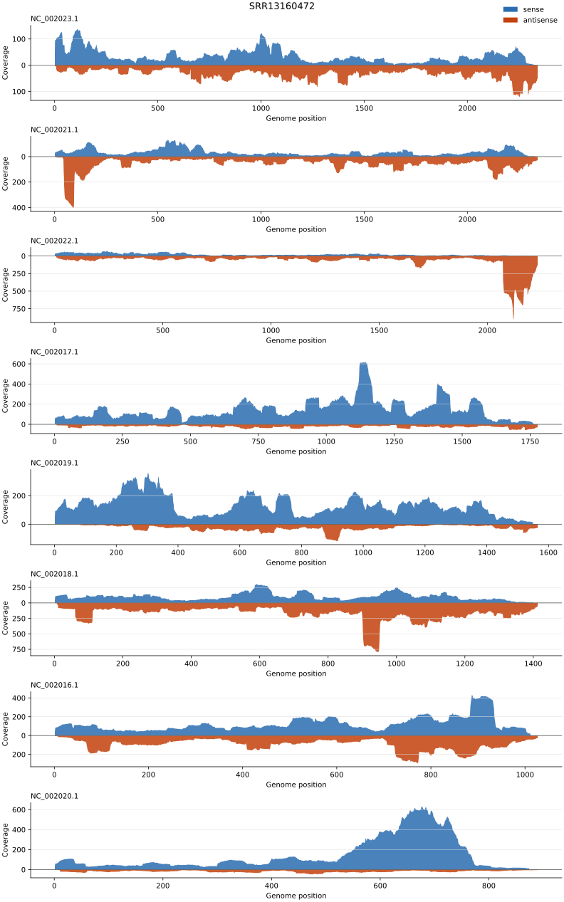
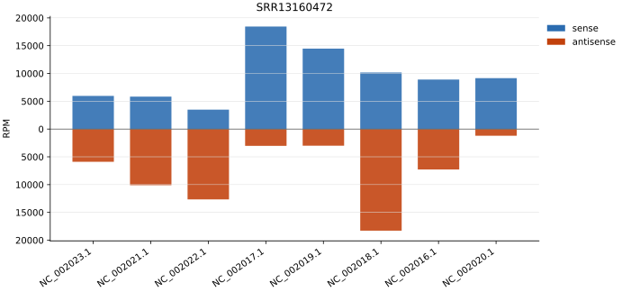

# viral_read_quantifier

RNA-seq read mapping and strand-specific quantification pipeline for virome analysis.

## Requirements

- conda ([Miniforge](https://github.com/conda-forge/miniforge) recommended)
- Git

## Installation

```bash
git clone https://github.com/virus-informatics/virome_happybox.git
cd virome_happybox/viral_read_quantifier
conda env create -f environment.yml
conda activate viral_read_quantifier
```

This installs `viral_read_quantifier` with the `index`, `map`, `visualize`, and `run` subcommands.

## Tutorial: Run with example data

The `example/` directory contains a small dataset for a quick test run. See `example/README.md` for details on the data.

The example data originates from:

> Phan T, Fay EJ, Lee Z, Aron S, Hu WS, Langlois RA. Segment-specific kinetics of mRNA, cRNA and vRNA accumulation during influenza infection. J Virol. 2021 Apr 26;95(10):e02102-20. doi: 10.1128/JVI.02102-20. Epub 2021 Mar 3. PMID: 33658346; PMCID: PMC8139675.

```bash
viral_read_quantifier run \
    --genome example/GCF_000865725.1.sequence.fasta \
    --sra-info example/sra_info.csv \
    --strandedness-info example/strandedness_info.csv \
    --fastq-dir example/SRR13160472
```

This will:

1. Build a STAR genome index
2. Run fastp QC and STAR mapping
3. Quantify viral RNA (separately by strand for strand-specific RNA-seq)
4. Generate per-sample coverage and RPM figures (SVG + PDF) under `output_dir/img/`

<!-- WARNING: adjust path to Github -->




## Quick Start

The `run` subcommand accepts either FASTQ or BAM/SAM files as input and executes the corresponding pipeline.

Both input formats require two CSV files:

**SraRunInfo CSV** (`--sra-info`):

| Column        | Description                  |
| :------------ | :--------------------------- |
| Run           | Sample ID (e.g. SRR28284612) |
| LibraryLayout | `PAIRED` or `SINGLE`         |

**Strandedness CSV** (`--strandedness-info`):

| Column       | Description                                             |
| :----------- | :------------------------------------------------------ |
| Run          | Sample ID (must match SraRunInfo)                       |
| strandedness | `fr-firststrand`, `fr-secondstrand`, or `fr-unstranded` |

### FASTQ mode

Runs the full pipeline: STAR index build → fastp QC → STAR mapping → strand separation → quantification → visualization.

```bash
viral_read_quantifier run \
    --genome <reference.fasta> \
    --sra-info <sra_info.csv> \
    --strandedness-info <strandedness_info.csv> \
    --fastq-dir <fastq_dir>
```

| Option                     | Required | Default          | Description                                                                      |
| :------------------------- | :------: | :--------------- | :------------------------------------------------------------------------------- |
| `--genome`                 |    Y     | -                | Reference genome FASTA                                                           |
| `--sra-info`               |    Y     | -                | SraRunInfo CSV                                                                   |
| `--strandedness-info`      |    Y     | -                | Strandedness CSV                                                                 |
| `--fastq-dir`              |    N     | `<outdir>/fastq` | Directory containing FASTQ files                                                 |
| `-o`, `--output-dir`       |    N     | `output_dir`     | Working directory                                                                |
| `--threads`                |    N     | `4`              | Number of threads for STAR                                                       |
| `--limit-bam-sort-ram`     |    N     | -                | STAR `--limitBAMsortRAM` (bytes). Set when BAM sorting runs out of memory        |
| `--genome-sa-index-nbases` |    N     | auto             | STAR `--genomeSAindexNbases`. Auto-computed as `min(14, log2(GenomeLength)/2-1)` |
| `--genome-chr-bin-nbits`   |    N     | `8`              | STAR `--genomeChrBinNbits`                                                       |
| `--star-bin`               |    N     | search PATH      | Path to STAR binary                                                              |
| `--force`                  |    N     | -                | Re-run even if output already exists                                             |

FASTQ files are resolved from `--fastq-dir` using the `Run` column: `{Run}_1.fastq.gz` / `{Run}_2.fastq.gz` for paired-end, `{Run}.fastq.gz` for single-end.

### BAM/SAM mode

Skips index build, fastp, and STAR mapping. Runs strand separation → quantification → visualization from pre-aligned files.

```bash
viral_read_quantifier run \
    --sra-info <sra_info.csv> \
    --strandedness-info <strandedness_info.csv> \
    --alignment-dir <bam_dir>
```

| Option                | Required | Default      | Description                           |
| :-------------------- | :------: | :----------- | :------------------------------------ |
| `--sra-info`          |    Y     | -            | SraRunInfo CSV                        |
| `--strandedness-info` |    Y     | -            | Strandedness CSV                      |
| `--alignment-dir`     |    Y     | -            | Directory containing BAM or SAM files |
| `-o`, `--output-dir`  |    N     | `output_dir` | Working directory                     |
| `--threads`           |    N     | `4`          | Number of threads                     |
| `--force`             |    N     | -            | Re-run even if output already exists  |

BAM files must be coordinate-sorted. SAM files are sorted internally. Files are resolved as `{Run}.bam` or `{Run}.sam`.

> [!NOTE]
> RPM denominators are computed from `samtools stats` `raw total sequences` (primary alignments only, excluding secondary/supplementary). Because the presence of unmapped reads depends on how the BAM was produced, the denominator may differ from FASTQ mode (which uses fastp `after_filtering.total_reads`). A warning is printed at runtime.

## Outputs

```
<outdir>/
├── fastp/
│   └── {Run}/                              # fastp QC reports (FASTQ mode only)
├── star_index/
│   └── {genome}/                           # STAR genome index (FASTQ mode only)
├── star/
│   └── {genome}/
│       └── {Run}/                          # STAR mapping results (FASTQ mode only)
├── summary/
│   ├── all_samples.strand_counts.tsv       # Merged strand counts (all samples)
│   └── all_samples.strand_depth.tsv        # Merged strand depth (all samples)
└── img/
    ├── {Run}.strand_coverage.svg           # Coverage depth plot (SVG)
    ├── {Run}.strand_coverage.pdf           # Coverage depth plot (PDF)
    ├── {Run}.strand_rpm.svg                # RPM bar chart (SVG)
    └── {Run}.strand_rpm.pdf                # RPM bar chart (PDF)
```

## Troubleshooting

### "command not found: viral_read_quantifier"

Ensure the conda environment is activated:

```bash
conda activate viral_read_quantifier
```

### STAR BAM sorting memory error

When the reference genome is small, STAR may fail with `not enough memory for BAM sorting`. The pipeline automatically retries with the RAM value suggested by STAR. If you need to override this value (e.g. on a memory-constrained node), use `--limit-bam-sort-ram`:

```bash
viral_read_quantifier run ... --limit-bam-sort-ram 2000000000
```

## Running Individual Commands

If you prefer to run each step separately instead of using `run`, use `index`, `map`, and `visualize`.

### 1. index

Build a STAR genome index from a reference FASTA:

```bash
viral_read_quantifier index --genome <reference.fasta>
```

| Option                     | Required | Default      | Description                                                                      |
| :------------------------- | :------: | :----------- | :------------------------------------------------------------------------------- |
| `--genome`                 |    Y     | -            | Reference genome FASTA                                                           |
| `-o`, `--output-dir`       |    N     | `output_dir` | Working directory                                                                |
| `--threads`                |    N     | `4`          | Number of threads                                                                |
| `--force`                  |    N     | -            | Re-run even if output already exists                                             |
| `--genome-sa-index-nbases` |    N     | auto         | STAR `--genomeSAindexNbases`. Auto-computed as `min(14, log2(GenomeLength)/2-1)` |
| `--genome-chr-bin-nbits`   |    N     | `8`          | STAR `--genomeChrBinNbits`                                                       |
| `--star-bin`               |    N     | search PATH  | Path to STAR binary                                                              |

### 2. map

Run fastp QC, STAR mapping, strand separation, and quantification. Requires a pre-built STAR index (`--index-dir`) for FASTQ mode.

FASTQ mode:

```bash
viral_read_quantifier map \
    --sra-info <sra_info.csv> \
    --strandedness-info <strandedness_info.csv> \
    --index-dir <star_index_dir> \
    --fastq-dir <fastq_dir>
```

BAM/SAM mode:

```bash
viral_read_quantifier map \
    --sra-info <sra_info.csv> \
    --strandedness-info <strandedness_info.csv> \
    --alignment-dir <bam_dir>
```

| Option                 |     Required     | Default          | Description                                                                  |
| :--------------------- | :--------------: | :--------------- | :--------------------------------------------------------------------------- |
| `--sra-info`           |        Y         | -                | SraRunInfo CSV                                                               |
| `--strandedness-info`  |        Y         | -                | Strandedness CSV                                                             |
| `--index-dir`          |  Y (FASTQ mode)  | -                | STAR index directory (output of `index`)                                     |
| `--fastq-dir`          |        N         | `<outdir>/fastq` | Directory containing FASTQ files                                             |
| `--alignment-dir`      | Y (BAM/SAM mode) | -                | Directory containing BAM or SAM files. Mutually exclusive with `--fastq-dir` |
| `-o`, `--output-dir`   |        N         | `output_dir`     | Working directory                                                            |
| `--threads`            |        N         | `4`              | Number of threads                                                            |
| `--limit-bam-sort-ram` |        N         | -                | STAR `--limitBAMsortRAM` (bytes). Set when BAM sorting runs out of memory    |
| `--star-bin`           |        N         | search PATH      | Path to STAR binary                                                          |
| `--force`              |        N         | -                | Re-run even if output already exists                                         |

> [!NOTE]
> In BAM/SAM mode, RPM denominators may differ from FASTQ mode. See [BAM/SAM mode](#bamsam-mode) for details.

### 3. visualize

Generate per-sample coverage and RPM figures from the TSV outputs of `map`:

```bash
viral_read_quantifier visualize \
    --depth-tsv <outdir>/summary/all_samples.strand_depth.tsv \
    --counts-tsv <outdir>/summary/all_samples.strand_counts.tsv
```

| Option               | Required | Default      | Description                         |
| :------------------- | :------: | :----------- | :---------------------------------- |
| `--depth-tsv`        |    Y     | -            | Merged strand depth TSV from `map`  |
| `--counts-tsv`       |    Y     | -            | Merged strand counts TSV from `map` |
| `-o`, `--output-dir` |    N     | `output_dir` | Working directory                   |
